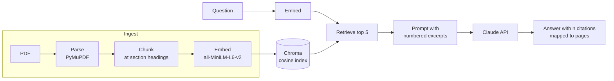

# PaperPilot

**Ask questions about research papers and get answers that cite the exact section and page.**

PaperPilot is a full-stack retrieval-augmented generation (RAG) app. Upload papers, ask questions, compare papers side
by side, and generate summaries. Every claim in an answer links back to the page it came from.

**[Live demo](https://paperpilot-mu-five.vercel.app/)** (password-protected; demo password on request)


## Features

- **Cited answers.** Answers use only the retrieved excerpts. Each `[n]` maps to a section and page, and links open
  the PDF at that page.
- **Says when it doesn't know.** If the excerpts don't cover a question, the model returns a fixed "not covered"
  sentence instead of answering from its training data.
- **Multi-paper search and compare mode.** Search one paper, several, or all of them. Compare mode retrieves from each
  paper separately, so one paper can't crowd out the others.
- **Summaries with citations**, built from the paper's own chunks in reading order.
- **Notes** per paper, saved in SQLite and exportable to Markdown.
- **Answer caching** keyed on the question, model, prompt and a fingerprint of the index, so cached answers go stale
  automatically when the papers change. Repeat questions return in about 0.02 s instead of 3 s.
- **Production deployment** with password sign-in, an owner role for uploads, and daily usage limits that cap API cost.

## Architecture



| Layer | Technology |
| --- | --- |
| Frontend | Next.js 16 (App Router), React 19, TypeScript, CSS Modules |
| Backend | FastAPI, Python 3.12 |
| Retrieval | Chroma (local vector DB, cosine distance), all-MiniLM-L6-v2 embeddings, optional BM25 hybrid search |
| Generation | Claude API (Anthropic SDK) |
| Storage | SQLite for notes, cache and usage limits |
| Deployment | Vercel (frontend), Fly.io with Docker and a persistent volume (API) |

The browser only talks to the Vercel origin. Next.js rewrites `/api/*` to the API on Fly, so the API needs no CORS
configuration.

### Pipeline

Each stage is a plain function with a simple input and output, so any piece can be measured or swapped on its own.

| Stage | File | What it does |
| --- | --- | --- |
| Parse | `step1_parse.py` | Extracts text page by page, drops page numbers and figure noise, rejoins hyphenated words, detects section headings and footnotes. |
| Chunk | `step2_chunk.py` | Splits at section headings, then into overlapping windows of up to 220 tokens (80 overlap). Each chunk keeps its paper, section and page range. |
| Embed and retrieve | `step3_embed.py` | Stores chunks in Chroma and returns the closest chunks to a question, optionally filtered by paper. |
| Answer | `step4_answer.py` | Builds the prompt from numbered excerpts, calls Claude, and maps each `[n]` back to its source. |
| Summarize | `step9_summary.py` | Summarizes one paper from its chunks with citations. |
| Notes and cache | `step10_notes.py`, `step11_cache.py` | SQLite notes with Markdown export; exact-match answer cache. |
| API | `step7_api.py`, `auth.py`, `deploy.py` | FastAPI endpoints, signed-cookie auth, usage limits, uploads. |
| Web app | `web/` | Next.js frontend: chat, compare, summaries, notes, paper library. |

## Evaluation

I wrote a 20-question retrieval benchmark (`eval/questions.json`) with a gold page and answer phrase for each question,
spread across five types: exact fact, paraphrase, table number, concept, and who/relation. `step5_eval.py` scores
retrieval alone, with no LLM, so a bad answer can be traced to either search or generation.

Results on *Attention Is All You Need* (answer phrase found in the top *k* chunks):

| Hit@1 | Hit@5 | Hit@10 |
| --- | --- | --- |
| 60% | 95% | 100% |

I used the benchmark to test alternatives against this baseline. Each had to clear a success bar set before the run
(+2 questions at rank 1, nothing lost from the top 5).

| Experiment | Hit@1 / Hit@5 / Hit@10 (of 20) | Outcome |
| --- | --- | --- |
| Baseline (PyMuPDF, heading-aware chunks, vector search) | 12 / 19 / 20 | |
| Chunk size and overlap sweep (12 settings) | rank-1 hits ranged 6-11, no trend | Chunking isn't the bottleneck |
| Hybrid BM25 + embeddings (reciprocal rank fusion) | 13 / 19 / 19 | Fixed one paraphrase, broke a synonym question; kept as an option |
| Unstructured parser (`fast` / `hi_res`) | 11 / 17 / 19 and 9 / 17 / 18 | Mixed footnotes into body text; PyMuPDF kept |
| LangChain loader, splitter and Chroma wrapper | 9 / 12 / 18 (defaults), 9 / 18 / 20 (sized to match) | Default chunks exceed the embedding model's 256-token limit |

The questions were written with the paper in hand, so absolute numbers are optimistic. The comparisons between
pipelines are the useful part.

## Design decisions

- **Chunk size follows the embedding model.** all-MiniLM-L6-v2 silently truncates input after 256 word pieces.
  Chunks are counted with the model's own tokenizer (a word-count estimate was off by up to 2x) and capped at 220.
- **Chunks never cross a section heading**, which keeps embeddings focused and section labels accurate.
- **Citations map by position, not by the model's memory.** `[1]` is the first excerpt in the prompt, so the page
  comes from metadata stored at ingest, never from the LLM.
- **The paper's own `[n]` references are rewritten to `(ref n)`** before generation, so the model can't copy one and
  point to the wrong excerpt.
- **Compare mode filters per paper** instead of running one big search, because a dense paper would otherwise take
  every top-5 slot.
- **The deployment fails closed.** Without a password configured, every protected endpoint refuses requests. Paid
  answers are reserved in a single SQLite transaction against both a site-wide and a per-session daily limit, and
  refunded if the Claude API call fails.

## Running locally

Requires Python 3.12, Node.js 20+, and an Anthropic API key for answers (search works without one).

```bash
python3 -m venv .venv
source .venv/bin/activate
pip install -r requirements.txt

mkdir -p papers
curl -L -o papers/attention.pdf https://arxiv.org/pdf/1706.03762v7
python step3_embed.py ingest papers/*.pdf

export ANTHROPIC_API_KEY=...
python step7_api.py serve            # API on http://127.0.0.1:8000
```

In a second terminal:

```bash
cd web
npm install
npm run dev                          # app on http://localhost:3000
```

Command-line tools:

```bash
python step3_embed.py ask "What is scaled dot-product attention?"   # retrieval only
python step4_answer.py ask "How many attention heads are used?"      # cited answer
python step5_eval.py run --label current                            # benchmark scores
python step7_api.py selftest                                        # offline API tests
```

## Deployment

The frontend runs on Vercel and the API on Fly.io (one shared-cpu-1x machine with 1 GB RAM, stopped when idle). The
Docker image downloads four pinned arXiv papers and builds their index at build time, so a cold start downloads
nothing. The index, uploads and SQLite data live on a persistent volume.

Security and cost controls:

- Signed HttpOnly session cookies with separate visitor and owner roles
- Rate limit on failed sign-ins
- Only the owner can upload or delete papers (size, page and library limits)
- 40 paid answers per day site-wide and 10 per session
- Spending cap on a separate demo API key

Full setup steps are in [docs/DEPLOY.md](docs/DEPLOY.md).

## Project structure

```
step1_parse.py ... step11_cache.py   RAG pipeline stages
step12_hybrid.py                     BM25 + reciprocal rank fusion
step13_parsers.py, step14_langchain.py   parser and framework comparisons
step7_api.py, auth.py, deploy.py     FastAPI app, auth, limits, deploy helpers
web/                                 Next.js frontend
eval/questions.json                  20-question benchmark
Dockerfile, fly.toml, entrypoint.sh  API container and Fly config
docs/                                deployment guide, system whiteboard
```

## Roadmap

- [x] Parsing, heading-aware chunking, vector search, cited answers
- [x] Retrieval benchmark and chunk-size sweep
- [x] Multi-paper search, compare mode, summaries, notes, caching
- [x] Hybrid search, parser and LangChain comparisons
- [x] Next.js frontend, deployed on Vercel and Fly.io
- [ ] User accounts with per-user libraries (PostgreSQL)
- [ ] Stronger embedding model, measured on the same benchmark

## License

MIT
